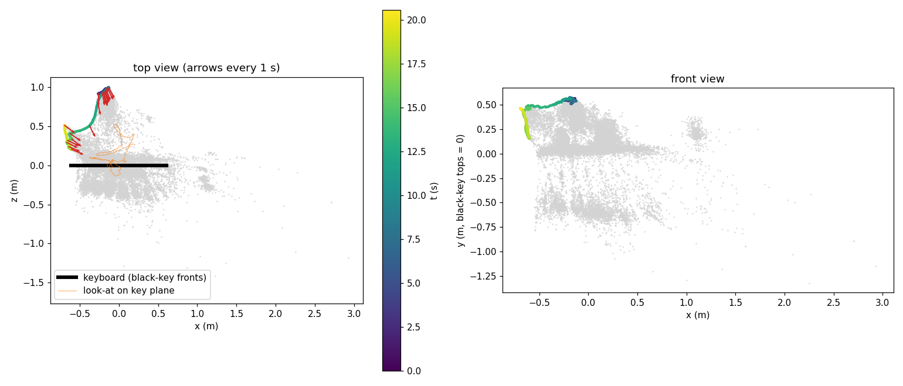
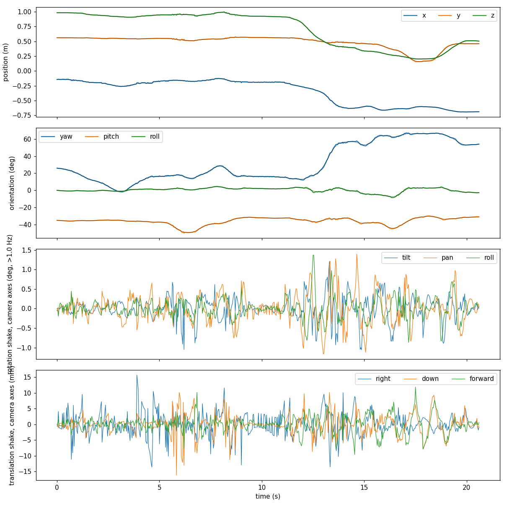
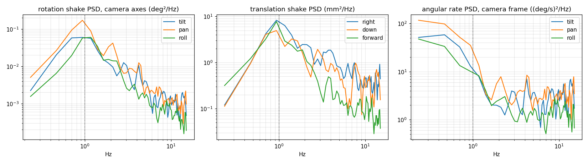
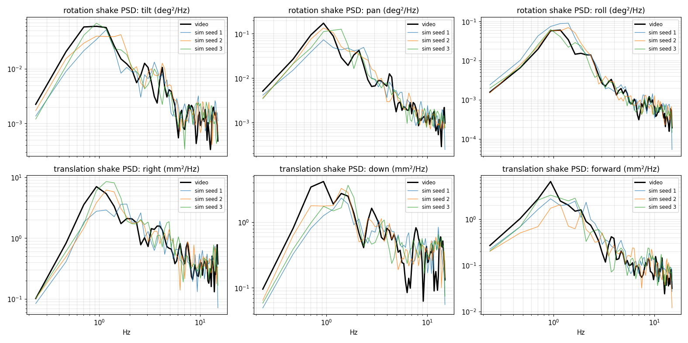

# CameraTrack — 从钢琴视频重建手持相机运动，并生成手持拍摄

输入：`Footages.local/VID_20261029_231550.mp4`，Android 手机竖屏拍摄，720×1280，30 fps，20.6 s，共 619 帧，拍的是一台 Roland FP-30。

输出：相机内参、每帧 6 自由度位姿（以键盘为世界坐标系，单位米）、手持运动的统计特征，以及一个按给定大致路径生成手持相机运动的生成器（`PianistWeb/src/handheld.js`）。

## 1. 方法

```
detect.py      每帧检测黑键（暗色、细长、近矩形的色块）
solve.py       黑键编号 + 只用键盘做的 PnP / BA（初值；也提供键位常量）
sfm.py         pycolmap 增量式 SfM：619 帧全部注册，所有帧共用一个 SIMPLE_RADIAL 相机
align.py       用黑键端点把 SfM 结果对齐到键盘坐标系（相似变换 + 尺度）
analyze.py     轨迹分解、运动特征、拟合生成器参数（handheld_params.json）
overlay*.py    诊断叠加图
```

**为什么最后用 SfM，而不是只用键盘。** 键盘是一维重复图案，只看键盘的 PnP 在侧拍、近拍、运动模糊的帧里不稳：编号会错一个八度，并且只能看到 4–6 个黑键。另外，单帧平面 PnP 无法同时确定焦距。房间里的墙纸、琴架、琴凳、地板提供了大量特征点，所以改为：
- 用 SfM 得到相对运动和内参：33.6k 个三维点，平均重投影误差 0.95 px；
- 键盘只用来确定世界坐标系和米制尺度：每帧黑键先投影，再就近关联，迭代加权拟合。

世界坐标系：x 沿键盘方向（E4|F4 交界处为 0，高音方向为 +x），y 向上，z 指向演奏者。黑键顶面所在平面为 y = 0，黑键前端为 z = 0。
相机坐标轴约定同 OpenCV：x 向右、y 向下、z 向前。

## 2. 内参（SfM 自标定）

| 参数 | 值 |
|---|---|
| 模型 | SIMPLE_RADIAL |
| f | **1050.1 px**：水平视场 37.8°（720 边），垂直 62.7°（1280 边）；按整幅视频画面折合 35 mm 等效焦距约 31 mm |
| 主点 | (360, 640)，固定在画面中心，未优化 |
| k1 | −0.023（轻微桶形畸变） |

## 3. 外参 / 轨迹

`camera.json`：每帧给出相机中心 `pos` 和相机到世界的旋转 `R`。`traj.csv`：时间、位置、航向角 yaw / 俯仰角 pitch / 地平线倾角 roll、视线与琴键平面的交点。




- 路径长 2.2 m。相机离视线落点 0.30–1.09 m。航向从正对键盘转到斜侧约 67°，俯仰 −50°…−30°（一直俯拍），地平线倾角 −8°…+5°。
- 叠加检查（`fig_overlay.png`）：正面帧里模型黑键与实拍完全重合，黑键端点中位重投影误差 5.1 px。

  **已知误差**：420–540 帧是斜侧近拍，模型约偏半个键宽，这几帧几乎检测不到黑键（每帧 0–2 个），所以世界坐标对齐在这一段主要靠 SfM 的连续性推出来。
  - 这个误差只影响"相机相对键盘的绝对位置"，大约厘米级；
  - 帧间相对运动来自 SfM，精度在亚毫米、0.1° 量级。下面的手持特征都是在相对运动上测的，不受这个误差影响。

## 4. 手持运动特征

分解方式：每个自由度 = 意图运动（零相位 1 Hz 低通）+ 抖动（残差）。抖动在相机自身坐标轴上度量：转动拆成 tilt / pan / roll，平移拆成右 / 下 / 前。



| 特征 | 数值 | 含义 |
|---|---|---|
| 意图运动速度 | 中位 6.6 cm/s，p95 35 cm/s | 慢速移动，72% 的时间在动 |
| 意图角速度 | 中位 9 °/s，p95 20 °/s | 缓慢摇镜 |
| 转动抖动 RMS | tilt 0.29°，pan 0.37°，roll 0.26° | 左右摇动最大 |
| 平移抖动 RMS | 右 3.7，下 3.2，前 2.7 mm | |
| 抖动角速度 RMS | 6.1 / 6.9 / 4.5 °/s | |
| 频谱 | 峰值约 1 Hz；1–10 Hz 内转角 PSD ∝ f^−1.7…−2.0 | 大于 2 Hz 时角速度谱近似白噪声 |
| 相关时间 | 0.13 s | |
| pan→roll 相关 | ρ = 0.32 | 手腕左右摇时会顺带扭转手机 |
| 杠杆臂 | 摇动 → 侧移 0.19 m（ρ 0.34）；俯仰 → 上下 0.27 m（ρ 0.42） | 手机绕手腕 / 肘部转动，而不是绕镜头中心 |
| 运动 / 持稳 | 移动时抖动是持稳时的 **2.8 倍**（0.38° vs 0.14°） | |
| 峰度 | 5–10 | 抖动是阵发的（脚步、换手），不是平稳的高斯噪声 |

**一个重要发现**：抖动要在相机自身坐标轴上分解。手机自身的一个小 pan，在世界坐标里会同时表现为航向抖动和地平线抖动。如果在世界坐标里独立生成航向和 roll，相机会出现虚假的滚转角速度，第一版生成器就出了这个问题：roll 角速度是实测的 3.7 倍。

## 5. 生成方案：`PianistWeb/src/handheld.js`

```
关键帧 {t, position, target, roll?}
  → 向心 Catmull–Rom 意图路径
  → 操作者跟随：临界阻尼二阶系统，跟随时间 0.22 s（起停平滑，转折处略有滞后）
  → + 手抖：
      转动：tilt / pan / roll 三路有色噪声（实测功率谱，随机相位逆 FFT 合成，循环取样），roll 中加入 ρ·pan 分量
      平移：杠杆臂分量（由转动推出）+ 独立的手部漂移
      增益：随"操作者活动度"从 1×（持稳）升到 3×（走动或摇镜），并对整条路径归一化
  → 相机位姿
```

```js
import { HandheldCamera } from './handheld.js';
import params from '../../CameraTrack/handheld_params.json';

const hc = new HandheldCamera( params, { seed: 7, intensity: 1 } );
hc.setPath( [
	{ t: 0, position: [ -0.2, 1.4, 0.75 ], target: [ 0, 0.72, -0.1 ], roll: 3 },
	{ t: 6, position: [ -0.6, 1.2, 0.20 ], target: [ 0.1, 0.72, -0.1 ] },
] );
// 每帧调用：hc.update( seconds, camera )
```

参数说明：
- `intensity`：整体抖动强度。
- `moveGain`：移动时与持稳时抖动之比。
- `followTime`：跟随的迟滞时间。
- `seed`：随机种子；同一种子结果可完全复现。

**验证方法**：把视频自身的意图路径（`intended_keys.json`）输入生成器，用同一个 `analyze.py` 分析生成结果，与实拍对比。命令：

```
node PianistWeb/tools/simulate-handheld.mjs <seed>
python3 analyze.py camera_sim<seed>.json _sim<seed>
```



| | 实拍 | 生成（3 个种子） |
|---|---|---|
| 转动 RMS（tilt / pan / roll，°） | 0.29 / 0.37 / 0.26 | 0.27–0.30 / 0.37–0.40 / 0.24–0.31 |
| 平移 RMS（右 / 下 / 前，mm） | 3.7 / 3.2 / 2.7 | 3.9–4.5 / 3.1–3.4 / 2.2–2.8 |
| 角速度 RMS（°/s） | 6.1 / 6.9 / 4.5 | 7.1–7.5 / 7.2–7.7 / 4.7–5.4 |
| 移动 / 持稳 | 2.8× | 2.1× |
| 峰度 | 5–10 | 3.1–3.8 |

调试中修正过的问题，记录下来供以后参考：
1. 抖动必须在相机坐标轴上生成（见第 4 节）。
2. 用逆 FFT 合成噪声时，±f 一对频点的幅值应取 √(S·df)/2；原来写成 √(S·df/2)，方差多了一倍。
3. 实测抖动是 1 Hz 高通之后的残差，导出功率谱时要除掉一次 (1−|H|²)²，否则 1 Hz 附近会被衰减两次。
4. 功率谱按对数频带取平均，不要取单点：带噪声的 Welch 估计取单点容易落在局部峰上。
5. 合成上限之外（>13 Hz）按 f⁻⁴ 衰减，避免 30 fps 渲染时混叠回可见频段。

## 6. 局限与可改进处

- **阵发性不足**：峰度 3.5 对 5–10。可以加一个泊松冲击过程：移动时以约 1.8 Hz（步频）触发带阻尼的小冲击，每次 0.5–1°，衰减时间约 0.1 s。
- 移动 / 持稳之比 2.1，低于实测的 2.8；可以调大 `moveGain`，或让增益延迟一点跟随活动度。
- **世界坐标对齐**：斜侧近拍段偏约半个键宽。改进方法有两种：检测白键前沿或键盘外框作为额外约束；或者用 SfM 点云拟合琴面平面，固定"上"方向。
- 主点固定在画面中心；只用了一个视频，所以统计结果代表这一位拍摄者、这一种手机。
- 卷帘快门没有建模：快速摇动时的帧内畸变会被当成很小的位姿噪声。

## 7. 复现

```
pip install --target .pylib pycolmap==3.13.0 --no-deps   # 本机没有 python3-venv
python3 detect.py && python3 solve.py
PYTHONPATH=.pylib python3 sfm.py        # CPU 约 1 小时
PYTHONPATH=.pylib python3 align.py      # ALIGN_L=0.095（默认）；设为 free 则同时拟合黑键长度
python3 analyze.py
```
